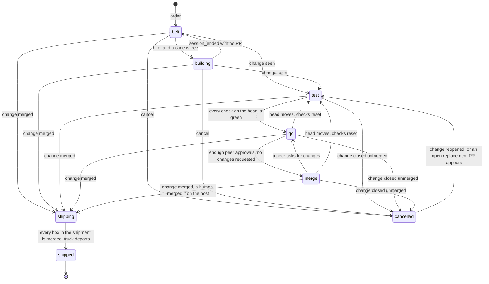

# Task lifecycle as a checked reducer

This page describes `packages/core/src/lifecycle.ts`, the pure model of how a box, its change (a PR on GitHub, an MR on GitLab) and its shipment move. HQ feeds it hook, webhook, poll and human events. It returns the next state and a list of commands for HQ to carry out. No command can merge, so the rule "HQ never merges" holds because the type has no such command, and a test also checks it.

The model has no I/O, no clock and no randomness. Every timestamp comes in on an event.

## Rerun it

```sh
pnpm test packages/core
LIFECYCLE_EVIDENCE_DIR=/tmp/swarm-P0-7/owner-r3/lanes pnpm test packages/core
LIFECYCLE_SEED=1 pnpm test packages/core
pnpm vitest run --config packages/core/vitest.perf.config.ts
node scripts/mutate-core.mjs all
```

The first prints each invariant with its run count and seed. The second also writes one file per lane. The third reruns every property under another seed (the default is 20261117, fixed, so a failure reproduces). The fourth is the throughput probe. It lives in `packages/core/test/lifecycle.perf.ts`, which the default `pnpm test` never collects, so it cannot be skipped by accident. CI runs it and then `scripts/check-throughput.mjs`, which fails unless three small-state runs of at least 200,000 events each, a large-state run of at least 20,000 events with at least four chunk rates and its median were printed, all with a numeric events per second. A run with `LIFECYCLE_PERF_TASKS=10` or a hand-written ten-event line fails both the probe and the checker. The fifth applies the wrong versions of `lifecycle.ts` (and, for the `_BOTH` ones, of `oracle.ts`) listed in `scripts/core-mutants.mjs`, 80 in all, runs only the two property files against each and reports which lanes catch it, under four seeds.

**File names against the plan.** The plan's checkboxes name one file, `packages/core/test/lifecycle.property.test.ts`. The suite is split instead, because one file ran past the time a reviewer waits for a failure: `lifecycle.invariants.test.ts` (lanes 2 to 7, 11, 12, 15), `lifecycle.convergence.test.ts` (lanes 8, 9, 13, 14), `lifecycle.vacuity.test.ts` (lane 10), `lifecycle.examples.test.ts`, `lifecycle.payload.test.ts` (the oracle rejects a wrong field in a command) and `lifecycle.fixtures.test.ts` (the P0-4 replay, lane 1), with `lifecycle.perf.ts` outside the default run. The plan's two checkboxes that name `lifecycle.property.test.ts` are satisfied by those files together, and the plan file itself is left unchanged.

## The data shape

| Type | Shape | Notes |
| --- | --- | --- |
| `Login` | `string` branded as `Login`, lower-cased once by `toLogin` | Every event enters through `reduce`, which converts each login field once. The state, the rules and the commands only hold `Login`. A raw string no longer type-checks where a login is wanted. |
| `Box` | Union by `state`: `belt`, `building`, `test`, `qc`, `merge`, `shipping`, `shipped`, `cancelled` | The state is the station. A box holds its task id, shipment id, order number, the `worker` of the current session, `builders` (the sorted set of every login ever hired for it, kept after the session ends) and a `cancelled` flag. `qc` also holds the assigned reviewer and whether changes were requested. |
| `Change` | Union by `state`: `open`, `closed`, `merged`, keyed by `repo#number@branch` | Holds the repo (lower-cased on entry, like a login), the number (a number, never part of a sorted string), the branch the PR was first seen on, the author and the head sha, the last two stamped with the host time of the event that set them, and `first`, the smallest host time of any fact about it. `merged` absorbs every later event. A PR whose head repo is not its base repo is dropped on arrival. |
| `Shipment` | Union by `state`: `loading`, `blocked`, `departed` | Holds its declared size and member task ids. A single task ships alone, in a shipment named after the task. |
| `State` | `{ config, seq, staff, boxes, changes, checks, reviews, shipments }` | Plain JSON. No `Map`, no `Set`, no `undefined`, so `JSON.parse(JSON.stringify(state))` is the same state. |
| `Event` | `human`, `hook`, `webhook` and `poll` | See the table below. |
| `Command` | `start_cage`, `release_cage`, `request_review`, `send_review_to_author`, `notify_ready`, `close_task`, `dispatch_truck`, `alert_human` | Eight kinds. There is no merge kind. |

`reduce(state, event)` returns `{ state, commands }`. `createReducer(rules)` builds the same function from a rule set. The only rule today is `canReview(reviewer, author)`, which the mutant lane overrides.

### Events

| Source | Event | What it sets |
| --- | --- | --- |
| human | `add_worker` | Puts a login in the staff list that reviewers are drawn from. |
| human | `order` | Creates a box on the belt in its shipment. A shipment declares its size on its first order. |
| human | `hire` | Names the worker for a box on the belt and adds that login to the staff, so a hired worker is also a candidate reviewer for other boxes. The box starts building when a cage is free, otherwise it waits. A hire is accepted only where no worker is running, which means the belt (a box waiting for a cage may change its worker). At any other station it changes nothing and raises `hire_refused`, because a swap on a building box would change the worker without a `start_cage` or `release_cage`. Hiring the name the box already has is a no-op. |
| human | `cancel` | Cancels a box that has no merged change. On a box that is `shipping` or `shipped` it changes nothing and raises `cancel_refused`, because the change already landed. |
| hook | `session_ended` | The worker's session ended. Clears the worker, so a box that was building and has no PR goes back to the belt. |
| webhook | `change`, `review`, `check` | Facts about a change on the host. Each carries the host time `at`. |
| poll | one snapshot of a change | The same facts as the three webhook events, in one object. |

A webhook or poll event is a fact, not an instruction. Facts join by last write wins on `at`, with the value as tie-break, except that `merged` always wins. A join is commutative, associative and idempotent, so the reducer cannot tell a duplicate or a late delivery from the original. After each event the reducer derives every box's station from the facts that exist. It never moves a box because of the event that arrived.

What a host adapter must supply on a `change` fact or a poll: repo (the base repo), head repo, number, head branch, author login, state, head sha and host time. Review facts carry the reviewer login and the sha they were given on. P0-4's `GitHostEvent` drops the author, reviewer, review commit, head repo and every timestamp, and the P1-2 parser must keep all of them.

### Which change a box follows

A change is identified by repo, number and branch (`repo#number@branch`, repo in lower case). A box follows one change on its branch `aw/<task>`. The choice uses only the facts, so arrival order cannot change it. Each change carries `first`, the smallest host time of any fact about it, which is a minimum and so joins like every other fact.

1. **A box follows the change it saw first for as long as that change is open or merged.** "First" means the smallest `first`, then the lower repo name, then the lower number as a number (`r#9` before `r#10`). A later PR on the same branch never takes the box, whatever its repo name, number or state. A merged change on another PR is not a reason to move either.
2. **Only if the followed change is closed (not merged) may another take over.** The next change in the same order that is open or merged becomes the followed one. If it is open, the box goes from `cancelled` back to `test`. If it is merged, the box ships on it. If every change on the branch is closed, the box is cancelled for `closed`.
3. **Every other open or merged change on the branch is a stray.** A stray never moves the box, and `duplicate_pr` is raised once when it becomes a stray. A merged stray is the case that needs a person: the work landed on a PR the box does not follow. The alert is the person's cue to close the followed PR, after which rule 2 hands the box to the merged one.
4. **A box that is `shipping` or `shipped` is latched.** It keeps the change it shipped on and the reducer does not place it again, so a late fact about an older sibling cannot pull a shipping box back. This is the one place where the end state can depend on arrival order, see the reorder lane below.

A closed change is history. When the agent opens a replacement PR after a close, rule 2 applies: the replacement is the first change that is open, and the box follows it from `cancelled` back to `test`. This is the documented rule that answers "the box and its shipment stay stuck after a cancel". If the closed PR is reopened, it is the first-seen change again and the box returns to it, and the replacement becomes a stray. A human `cancel` is different: the box stays cancelled whatever the PR does, until it ships on a merged change.

An earlier version ranked merged above open above closed and then by repo and number. That moved a box at `merge` to a later PR in a lower-sorting repo (probe X3, `aa/repo#7` against `zz/repo#5`), and a merged stray moved it too. The rule above replaces it.

**Which rule answers the odd cases.** A fork PR never becomes a candidate (it is dropped on arrival, see below). A renamed head branch is a new change on the new branch with its own `first`, so rule 1 applies on each branch separately and neither box is moved, and rule 3 does not apply because the two changes are on different branches. A replacement PR is rule 2. Two PRs opened at once on one branch are rule 1 with the repo and number tie-break. A PR opened after the box shipped is a stray under rule 4.

**A PR whose head branch changes (M1).** On GitHub renaming the head branch closes the PR, and GitLab behaviour is unverified, so the model does not assume a PR keeps its branch. A fact for the same repo and number on another branch is a different change, identified by its own key. The first change keeps its box and keeps its facts. The new one may be followed by the box of the other branch, and `change_branch_moved` is raised so a person sees it. Nothing restarts silently. Reviews are keyed by repo, number and head sha, because a review fact carries no branch, so the two changes share the reviews of one sha. That is a corner of a corner and is not worth another key.

**Fork PRs.** A change whose head repo differs from its base repo (both lower-cased on entry) is dropped on arrival, like a branch that is not `aw/<task>`. A fork can name its branch `aw/x/y`, so without this rule a stranger's PR could claim a task. The dropped fact raises no alert, because a dropped fact leaves the state unchanged and the reducer emits commands only from a change in state. The adapter must supply the head repo, see G1.

### Logins

GitHub and GitLab logins are case-insensitive. `toLogin` lower-cases a login once, where the event enters `reduce`, and the type `Login` is what the state, the rules and every command hold. `add_worker fiatfour` and an author `FiatFour` are the same account. Aliases, renamed accounts, bot accounts (`app[bot]`) and a human who uses two accounts are not modelled. The host adapter must map each person or app to one canonical login before it builds an event. Commands carry the lower-cased login, and change keys carry the lower-cased repo, so an executor must not use either where the host is case-sensitive. Repo names are lower-cased in `reduce` for the same reason: `Org/R` and `org/r` are one repository, and a close that names one must reach the open that named the other (probe X2).

A **builder** of a box is any login that was hired for it. The box keeps the set of all of them (`builders`, sorted), not only the last one, and the set survives the end of a session. The author is the login the host reports on the PR. The model assumes the author is one of the builders and also refuses every builder as reviewer and approver, because a cage may push under a name that differs from the author the host reports. A box that was hired as `w1`, lost its session and was hired again as `w2` refuses both (probe x8). The mapping from a worker name to a host login is a G1 question.

## State diagram



A shipment is `loading` until every declared member exists and is merged, `blocked` while a member is cancelled, and `departed` after that. `departed` is terminal. The reducer never recomputes a departed shipment, a box of a departed shipment is `shipped`, and a later PR on the same branch is a stray with an alert. New work for a task whose shipment has left needs a new task id, because a shipped box never takes another PR and a second `order` for the old id changes nothing. The property suite checks the transition on every step: a departed shipment is never `loading` again, a shipped box never leaves `shipped`, and `dispatch_truck` appears at most once per shipment over a whole run.

Cages are counted, not numbered. A box holds a cage exactly while it is `building`. A box leaves `building` when its PR appears, when its session ends without one, or when it is cancelled. The model does not send a box back through the belt after a review asks for changes. The author gets the comments (`send_review_to_author`) and the next push is a new head. Whether the revision needs a cage is a question for P1-1.

## Commands come from the change in state

The reducer compares the state before and after an event and emits a command for each transition: `start_cage` and `release_cage` when a box enters or leaves `building`, `request_review` and `send_review_to_author` at `qc`, `notify_ready` when a box reaches `merge`, `close_task` when its change is merged, `dispatch_truck` when a shipment departs and `alert_human` for the cases a person must see. A duplicate event changes no state, so it emits no command. A command that must survive a crash needs an outbox in the state store, see G1 below.

An alert caused by a rejected human or hook event (an order that conflicts with its shipment, a hire for an unknown task, a hire at a station that has a worker running, a cancel of a shipping box) is emitted again if that event is delivered again. There are eleven alert reasons: `invalid_task`, `unknown_task`, `order_conflict`, `no_peer_reviewer`, `worker_ended_without_pr`, `change_closed_unmerged`, `duplicate_pr`, `change_branch_moved`, `shipment_blocked`, `hire_refused` and `cancel_refused`. Every alert is `{ kind, reason, subject }` and the checker compares all three.

**Order inside one batch.** All `release_cage` commands come before every `start_cage`. One event can free a cage and fill another (a PR appears on a building box, and a waiting box starts). The first version emitted the start first. An executor that runs the batch in order would then have budget plus one cages for a moment.

**How a stopping cage is modelled.** It is not. The model has two cage states for a box, building or not. `release_cage` means "this cage no longer counts", and the reducer frees the slot at once. The command stream property replays every batch in order and asserts that starts minus releases equals the running cages, per task, and never exceeds the budget at any prefix. The reducer's order is therefore safe for an executor that runs commands in order and waits for each release to finish before it runs the next command. An executor that fires the batch in parallel, or lets a release finish later than its start, can overshoot while the old cage stops. That is a P1-1 requirement, and the alternative (a `stopping` station and a `cage_stopped` hook event, so the slot is freed only on the acknowledgement) is a G1 question.

**Every merge is a human event.** There is no merge command. The command stream property also asserts that every command kind is one of the eight, that no string a command carries (task, shipment, change key, login) mentions a merge, that every alert reason is one of eleven, and that every alert subject names something that exists in the factory or in the event. A merge disguised as an alert subject therefore fails. A box begins shipping only on a host change fact (webhook or poll) or on the order of a task whose branch already has a merged change, never on a review, a check, a hire, a cancel or a hook event.

## Invariants and how each is checked

The checker is a separate program, `packages/core/test/oracle.ts`. It imports no value from the reducer, only its types. It keeps its own data layout: append-only arrays of the facts and human decisions it has seen, a flat ledger of boxes and shipments, its own lower-casing of logins, and its own grouping of changes by repo, number and branch. After every event it recomputes from scratch what each box, reviewer and shipment must be, and compares that with the reducer's state. It is slow on purpose. A bug in the reducer's `branchIndex`, its login comparison or its key sort cannot pass here as well, because none of that code is shared. The two compare their answers, so a mistake would have to be made the same way twice.

**Commands are compared whole.** The oracle derives, from its own ledger and its own reading of the event, the full list of commands the event must produce, every field of each: `start_cage` with the worker the box names, `request_review` with the task, the change key and the reviewer, `close_task` and `notify_ready` with the change key, `dispatch_truck` with the shipment, and every alert with its reason and subject, including the ones a rejected event raises (`invalid_task`, `unknown_task`, `order_conflict`, `hire_refused`, `cancel_refused`) and the two change alerts. It serialises each command as JSON with sorted keys and compares the two lists as bags. A missing command, an extra command, a command with another value in any field and a command with an extra field all fail. The stream monitor, which runs on 100,000 sequences without the oracle, applies the same comparison to the commands that follow from the state change (it leaves the alerts that need the event itself to the oracle). An earlier version compared a token per command (`request_review` was `task:reviewer`, `start_cage` had none), so a wrong `pr` or worker passed (verifier mutants R14 to R18).

**What is and is not re-derived independently.** The oracle shares no code with the reducer. Inside the oracle, the expected state and the invariants use two formulations. The expected state groups review facts by reviewer and filters with `eligible`. The invariants for `qc` and `merge` do not call either: they build the barred set (author and every builder) and fold the review facts into a latest vote per login with counters. Three rules are written once in the test code and used by both, so a mistake in one would pass: the tie-break of a join (later host time wins, then the larger value), the choice of the followed change (`firstOf`), and the cage budget arithmetic. They are the same rules the doc states, restated in `oracle.ts`, and the reducer does not read that file. The mutants `W1` to `W10` write the same bug into reducer and oracle to show which of these are caught anyway, and the mutant table in the PR lists the result per mutant.

Two monitors do the checking. The **stream monitor** looks at transitions and commands and needs no recomputation, so it runs on 100,000 sequences. The **oracle** adds the reference model and runs on 20,000. Both run on a generator that mixes hostile random events (random ids, conflicting shipments, a second PR on one branch, a PR that moves branch, a fork PR, mixed-case logins, PR numbers 1 to 30 and 98 to 101) with generated stories that walk tasks from order to merge: stale reviews, a second peer, changes requested then approved, a rename, a closed PR with a replacement, a human cancel at any point of the story, a short run of orders, hires, cancels, session ends and PRs under a small budget (the cancel storm), and shipments of two or three boxes. All sequences use one fixed seed (20261117, or `LIFECYCLE_SEED`) so a failure reproduces.

| Invariant | What is asserted | Lane |
| --- | --- | --- |
| HQ never merges | Every command kind is one of the eight and no string a command carries mentions a merge. Every alert reason is one of the eleven and every alert subject names a task, shipment or change that exists, or the task in the event. A box begins shipping only on a host change fact or on an order that finds one. | 2, 100,000 and 20,000 sequences |
| 1 task = 1 branch = 1 PR | A box follows a change that exists, whose branch is `aw/<task>`, and no change belongs to two boxes. | 3 |
| The author and the builders never review | A box in `qc` never has the author or any login hired for the box as reviewer. A box in `merge` has at least the configured number of approvals from other logins and no changes request from one. Case does not matter. A hire changes nothing at a station that has a worker running, and a cancel changes nothing on a shipping box. The cage the executor runs names the worker the box names. | 4 and 11 |
| A box is at exactly one station | The station is one of eight. A PR station has a change, `belt` and `building` have none, and `building` has a worker. | 5 |
| The truck leaves only when every PR in its shipment is merged | A departed shipment has every declared member, each with a merged change. `dispatch_truck` appears only for a shipment that departs in that step, and only once per shipment in a run. | 6 |
| Nothing exceeds the machine budget | At most `budget` boxes are `building`. | 7 |
| Duplicates and reordering | Duplicating and permuting the webhook and poll events after a fixed setup gives the in-order end state, including when a branch has two changes. A repeated event returns the same state object and no command. | 8 |
| Restart | Cut a sequence at a random point, `JSON.stringify` the state, parse it and continue. The end state and the whole command list equal the uncut run. | 9 |
| The checks are not vacuous | Seven wrong reducers (author may review, truck leaves early, a merge command, a merge hidden in an alert, start before release, a shipped box sent back, a second truck) each get a counterexample from the invariant meant to catch them. | 10 |
| Transitions and command streams | A departed shipment never becomes `loading` again. A box never leaves `shipped`, and `shipping` only goes to `shipped`. `dispatch_truck` and `close_task` appear once per shipment and task. Replaying the commands of the whole run in order, starts minus releases equals the boxes that are building, per task, and never passes the budget at any prefix. `notify_ready` is emitted exactly once when a box enters `merge`. | 11, 100,000 and 20,000 sequences |
| The reducer equals the reference model | Every box's station, change, reviewer, worker, builders and cancelled flag, every shipment's members and state, every change's author, head, state and first-seen time, the set of change keys, and the whole list of commands (every field) equal what the oracle derives from the events. | 12 and 11 |
| Purity | `reduce` leaves its input state and event unchanged, and returns the same result when the input is deep-frozen. | 13 |
| Liveness | From the state at the end of a random sequence, a recovery script of human and host events (fill the shipment, hire, open a PR where there is none, make the checks green, approve, merge) ends with every box shipped, or cancelled by a human, or merged in a shipment that holds a human-cancelled box. | 14 |
| The generator reaches the states the other lanes rely on | Each of stale-head review, budget full with a waiting box, a multi-box shipment departing, a merge while at `merge`, a second peer review, a rename, a replacement PR, a later PR after shipment, a fork change, a human cancel of a building box while the budget is full and others wait, and a human cancel of a waiting box while the budget is full occurs in some sequences out of 20,000. Lane 15 fails if one is zero. | 15 |

Reordering holds because the facts are joins and the choice of change is derived from them. A PR that changes branch no longer breaks it, because the branch is part of the change's identity. One case is outside the claim and the lane skips it, counting the skips: a branch that holds a merged change and another live (open or merged) one. A box latches on the change it ships on, so if an older sibling arrives after the merged one, the box has already shipped on the merged one, while in order it would have stayed on the older one. Whether the truck left, and on which change, then depends on arrival order. This is the price of never moving a shipping box back (rule 4 above). It holds for a webhook that arrives before the order, the hire or the PR it refers to. It does not hold for reordering human events, because a hire that comes before an order means something else.

**Deep-equal, not byte-equal.** After reordering, the end state equals the in-order one under `toStrictEqual`, which ignores the order of keys in an object. The serialised bytes can differ, because the state is built with spreads and keys appear in insertion order. G1 storage must therefore serialise with sorted keys (canonical JSON) before it hashes or compares a state, and must not use the byte string of a state as its identity.

**Dead ends.** The liveness lane is "liveness-lite". It asserts that an exit exists from the states the generator reaches, by running one recovery script, not that every schedule ends. A human-cancelled box is a deliberate end. A shipment that holds one cannot depart, because a shipment's size is fixed. The human's way out is to order the work again under a new shipment. Whether to add a resize event is a G1 question.

## Replay of the P0-4 fixtures

`spikes/P0-4/fixtures/github/` holds single recorded deliveries, not one ordered log, and they come from three different PRs. The test parses each with the P0-4 `parseEvent`, adds the fields the parser drops (author, reviewer, review commit, host time) and replays them in the order they happened on scratch PR #1. Steps the one-account scratch repo cannot produce are labelled `synthetic` in the output: the peer approval, and the merge webhook, which P0-4 lane 10 never recorded. The merge is the recorded `opened` body with `closed` and `merged: true`, the same edit the P0-4 parse test makes.

The recorded review is state `commented`, so the reducer would not count it as an approval whoever wrote it. By itself it proves little about the self-review rule. A second case therefore takes the same recorded body and sets its state to `approved` (labelled `synthetic`), and the box still does not move. The self-review rule is proved by that case and by the property lanes, not by the recorded fixture.

Result: the recorded author review is refused, the box stops at `qc` with `peer-reviewer` assigned, the peer approval moves it to `merge`, and the merge ends it in `shipped` with the change `merged`. The recorded `closed` payload for PR #2 (not merged) cancels its box and blocks its shipment, and the merged variant ships it. `push` and `pull_request_review_comment` map to no event, because a pull request event already carries the new head and a comment says nothing about the verdict. GitLab fixtures are docs examples, not recordings, and GitLab did not run (G0), so they are not replayed.

What the replay found: P0-4's `GitHostEvent` drops `pull_request.user.login`, `review.user.login`, `review.commit_id`, `pull_request.head.repo.full_name` and every timestamp. The reducer needs all five. The P1-2 parser must keep them.

## Numbers

Measured on 2026-11-17 on a WSL2 machine with 24 cores, Node 24.21, no baseline, trunk empty. Nothing else ran during the throughput runs. CI numbers are in the PR.

| Metric | Value | Rule |
| --- | --- | --- |
| Throughput, small states: 1,000,000 generated events in 5,000 runs of 200, each run from an empty state, three runs per probe, three probes | 231,782 to 272,345 events per second over the nine runs (probe 1: 246,407, 272,345, 269,242; probe 2: 231,782, 260,728, 266,337; probe 3: 243,591, 267,203, 269,539) | at least 10,000 per run, at least 200,000 events per run |
| Throughput, large state: 24,000 events for 3,000 tasks ordered and merged 25 at a time, the state never reset and nothing pruned, four chunks of 5,000 events | probe 3: 6,719 events per second with 638 boxes held, 1,469 at 1,260, 679 at 1,886 and 446 at 2,511. The median of the four chunk rates is the mean of the middle two, 1,074. The three probes give 1,056, 1,068 and 1,074. On CI the chunks were 7,021, 1,503, 772 and 476, median (1,503 + 772) / 2 = 1,138 | reported, no floor, at least 20,000 events and four chunk rates |
| Property suite (64 tests), three runs | 21.7, 21.5 and 22.0 seconds wall, 42 seconds of test time across the workers | median at most 120 |

**What the small-state number means.** It is the cost of one event when the factory holds at most six boxes, which is the case the generator reaches. The first version of this model measured about 390,000. The extra work since is the canonical login and repo conversion, the builder set and the choice of change by first sight. A profile of the run puts the time in allocation: `sameShallow` comparing every box, the record copies in `put`, the per-event index of changes by branch, and the command diff. One thread does all of it, which is why more cores do not help. The generated events are random, so most of them change nothing or fail a guard, and the number is a floor for cheap events, not a forecast of real traffic.

**What the large-state number means.** The cost per event grows with the number of boxes and changes the state holds, and faster than linearly in these four points: the rate fell 15 times (6,719 to 446) while the boxes held grew 3.9 times, so the cost per box per event rose from 0.2 to 0.9 microseconds. I did not isolate why the per-box cost grows. A guess, not measured, is that spreads and `Object.values` over objects with thousands of keys lose cache locality as they grow. The state keeps every box and every change it has seen, and each event copies the records it touches and scans the boxes and changes once or twice. A profile of the whole run (`node --cpu-prof`, 35 seconds of samples) puts 23.5% in `settle`, 19.1% in `put`, 13.7% in `commandsBetween`, 12.9% in `changesByBranch`, 11.7% in `promoteShipped` and 7.8% in `strayKeys`. All are linear passes over the state, which is the limiter. Skipping shipped boxes in `settle` and skipping unchanged records raised the 1,000-box result from 1,575 to 4,471 events per second, and what is left is the passes above. HQ's real event rate is a guess (webhooks and polls, a few per second at most), and at that rate 446 events per second at 2,500 held boxes is enough. The state still needs a pruning rule: move a shipped box, its change and the facts of its heads into an archive when the shipment departs. That is the G1 storage question below, and it should keep the large-state number near the small-state one. That is a prediction, not a measurement.

The state also holds every check and review for every head it has seen. Nothing is pruned before G1 decides, because pruning earlier would break reordering.

## What the operator decides at G1

**State storage.** The reducer needs one JSON document and one total order of events. Two shapes fit. A snapshot file replaced by an atomic rename, with the event log beside it. Or SQLite with a `state` row and an append-only `events` table written in one transaction. Both give restart equals uncut run, which lane 9 checks. Two things the store must add. An outbox, so a crash between saving the state and carrying out a command does not drop the command, and commands run at least once. And a pruning rule for the check and review facts of heads that a merged or closed change superseded, which cannot be done earlier without breaking reordering.

**Message protocol event schema.** The `Event` union above is a proposal. It names the fields a host adapter must supply: repo, number, branch, author login, reviewer login, head sha and host time. Open points: what the cage hooks send besides `session_ended` (the model has no `session_started`, and `start_cage` has no acknowledgement event), whether a hire should carry a runtime and a role, and whether the human events become Action item answers.

**Checker.** Property tests with fast-check are the default and are what runs here. The reference model in `oracle.ts` is a second, independent implementation of the station rules that the properties compare the reducer against. A TLA+ model would add three things that sampling cannot give. It explores every interleaving of a small instance (three boxes, two workers, a shipment of two) instead of a random sample, so a bug that needs one specific schedule shows up as a trace. It states liveness, such as "a merged change is eventually shipped, and no box waits forever under a free cage", which a property over finite sequences cannot say. The liveness lane here only shows that one recovery script exists from sampled states. And it models HQ, the webhook path, the poller and the human as separate actors with lost, duplicated and reordered messages as steps, which tests the idempotence claim against schedules the generator may never produce. The costs are a second language to keep in step with `lifecycle.ts`, with no check that the two agree unless traces from one are replayed through the other, and a model-checker run in CI. No TLA+ model is written here. The operator picks fast-check, TLA+ or both.

Two defaults to confirm along with it. A box whose review asks for changes stays in `qc` and does not rejoin the belt. And with one GitHub account no approval can come from a peer, so a box waits in `qc` until a second account or an app exists (G0 gap for P1-2).

New G1 questions from this round.

**Worker name versus host login.** `hire` names a worker, and the host reports an author login. The model treats the hired name and the author as the same account (compared without case), and refuses both as reviewer. If a cage pushes under an account other than the name HQ gave it, the adapter must map one to the other, or the hired name must be defined as the host login. The operator decides which side owns the mapping. The same mapping must cover aliases, renamed accounts and bot accounts, none of which the model handles.

**Adopt or replace events.** The model follows a replacement PR on its own when the followed one was closed (rule 2), and otherwise stays on the first change it saw (rule 1). A human who wants to pick a particular PR out of several open ones on one branch has no event for it: the first seen wins, and the way to hand the box to another PR is to close the first on the host. The alternative is a human `adopt_change` event that pins a box to one change. It costs a field in the state, and it makes the reorder lane's claim conditional on an order between a human event and the facts. The operator decides whether the automatic rule is enough.

**Fork PRs.** A fork PR is dropped when the head repo differs from the base repo. This needs the host adapter to report the head repo, which P0-4's parser drops. The alternative is to filter forks in the adapter and keep the reducer as it was. Dropping them in both places is safe.

**Cage release acknowledgement.** The model frees a cage when it emits `release_cage`. If the executor needs a `stopping` station and a `cage_stopped` hook event, the budget property changes: a stopping cage still counts.

**A shipment with a human-cancelled member.** It can never depart, and its other boxes stay at `shipping`. A `resize_shipment` event, or a rule that a human cancel removes the member, would let the rest ship.

