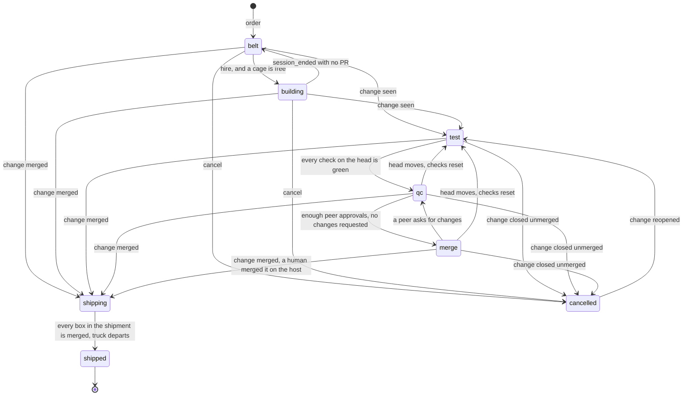

# Task lifecycle as a checked reducer

This page describes `packages/core/src/lifecycle.ts`, the pure model of how a box, its change (a PR on GitHub, an MR on GitLab) and its shipment move. HQ feeds it hook, webhook, poll and human events. It returns the next state and a list of commands for HQ to carry out. No command can merge, so the rule "HQ never merges" holds because the type has no such command, and a test also checks it.

The model has no I/O, no clock and no randomness. Every timestamp comes in on an event.

## Rerun it

```sh
pnpm test packages/core
LIFECYCLE_EVIDENCE_DIR=/tmp/swarm-P0-7/owner/lanes pnpm test packages/core
LIFECYCLE_PERF=1 pnpm test packages/core -t throughput
```

The first prints each invariant with its run count and seed. The second also writes one file per lane. The third runs the throughput probe, which is skipped by default.

## The data shape

| Type | Shape | Notes |
| --- | --- | --- |
| `Box` | Union by `state`: `belt`, `building`, `test`, `qc`, `merge`, `shipping`, `shipped`, `cancelled` | The state is the station. A box holds its task id, shipment id, order number, the worker hired for it and a `cancelled` flag. `qc` also holds the assigned reviewer and whether changes were requested. |
| `Change` | Union by `state`: `open`, `closed`, `merged`, keyed by `repo#number` | Holds the branch, author and head sha, each stamped with the host time of the event that set it. `merged` absorbs every later event. |
| `Shipment` | Union by `state`: `loading`, `blocked`, `departed` | Holds its declared size and member task ids. A single task ships alone, in a shipment named after the task. |
| `State` | `{ config, seq, staff, boxes, changes, checks, reviews, shipments }` | Plain JSON. No `Map`, no `Set`, no `undefined`, so `JSON.parse(JSON.stringify(state))` is the same state. |
| `Event` | `human`, `hook`, `webhook` and `poll` | See the table below. |
| `Command` | `start_cage`, `release_cage`, `request_review`, `send_review_to_author`, `notify_ready`, `close_task`, `dispatch_truck`, `alert_human` | Eight kinds. There is no merge kind. |

`reduce(state, event)` returns `{ state, commands }`. `createReducer(rules)` builds the same function from a rule set. The only rule today is `canReview(reviewer, author)`, which the mutant lane overrides.

### Events

| Source | Event | What it sets |
| --- | --- | --- |
| human | `add_worker` | Puts a login in the staff list that reviewers are drawn from. |
| human | `order` | Creates a box on the belt in its shipment. A shipment declares its size on its first order. |
| human | `hire` | Names the worker for a box on the belt. The box starts building when a cage is free, otherwise it waits. |
| human | `cancel` | Cancels a box that has no merged change. |
| hook | `session_ended` | The worker's session ended. Clears the worker, so a box that was building and has no PR goes back to the belt. |
| webhook | `change`, `review`, `check` | Facts about a change on the host. Each carries the host time `at`. |
| poll | one snapshot of a change | The same facts as the three webhook events, in one object. |

A webhook or poll event is a fact, not an instruction. Facts join by last write wins on `at`, with the value as tie-break, except that `merged` always wins. A join is commutative, associative and idempotent, so the reducer cannot tell a duplicate or a late delivery from the original. After each event the reducer derives every box's station from the facts that exist. It never moves a box because of the event that arrived.

## State diagram



A shipment is `loading` until every declared member exists and is merged, `blocked` while a member is cancelled, and `departed` after that. `departed` is permanent, because a merged change never un-merges.

Cages are counted, not numbered. A box holds a cage exactly while it is `building`. A box leaves `building` when its PR appears, when its session ends without one, or when it is cancelled. The model does not send a box back through the belt after a review asks for changes. The author gets the comments (`send_review_to_author`) and the next push is a new head. Whether the revision needs a cage is a question for P1-1.

## Commands come from the change in state

The reducer compares the state before and after an event and emits a command for each transition: `start_cage` and `release_cage` when a box enters or leaves `building`, `request_review` and `send_review_to_author` at `qc`, `notify_ready` when a box reaches `merge`, `close_task` when its change is merged, `dispatch_truck` when a shipment departs and `alert_human` for the cases a person must see. A duplicate event changes no state, so it emits no command. A command that must survive a crash needs an outbox in the state store, see G1 below.

An alert caused by a rejected human or hook event (an order that conflicts with its shipment, a hire for an unknown task) is emitted again if that event is delivered again.

## Invariants and how each is checked

All checks run `violations(state, commands)` after every event of a random sequence. The checker is written separately from the reducer, so a reducer bug cannot hide in shared code. Sequences mix hostile events (random ids, conflicting shipments, a second PR on one branch, reviews by the author) with generated stories that walk tasks from order to merge so that the random runs reach `merge`, `shipped` and a dispatched truck. The test prints how many sequences reached each.

| Invariant | What the checker asserts | Lane |
| --- | --- | --- |
| HQ never merges | Every command kind is one of the eight and none matches `merge`. | 2, 100,000 sequences |
| 1 task = 1 branch = 1 PR | A box follows only the first change on its branch, that change's branch is `aw/<task>`, and no change belongs to two boxes. A second PR on the same branch is never adopted and raises `duplicate_pr`. | 3 |
| The author never reviews its own PR | A box in `qc` never has its author as reviewer. A box in `merge` has at least the configured number of approvals from other logins and no request for changes from one. | 4 |
| A box is at exactly one station | The state is one of eight, and it agrees with the change: `test`, `qc` and `merge` mean an open change, `shipping` and `shipped` a merged one, `belt` and `building` no change. | 5 |
| The truck leaves only when every PR in its shipment is merged | A departed shipment has all its declared members, each with a merged change. A `dispatch_truck` command appears only for a shipment that is departed in the state it came with. | 6 |
| Nothing exceeds the machine budget | At most `budget` boxes are `building`, and a hire past the cap waits on the belt. | 7 |
| Duplicates and reordering | Duplicating and permuting the webhook and poll events after a fixed setup gives the in-order end state. A repeated event returns the same state object and no command. | 8 |
| Restart | Cut a sequence at a random point, `JSON.stringify` the state, parse it and continue. The end state and the whole command list equal the uncut run. | 9 |
| The checks are not vacuous | A reducer that lets the author review gets a counterexample. So does one where the truck leaves on the first merged PR, and one that emits a merge command. | 10 |

Reordering holds because the facts are joins, and it assumes the host contract that a PR's head branch never changes. If one PR number is reported on two branches, the later timestamp wins, and a box can gain and lose its PR in between, so the cage it frees may go to a different box depending on arrival order. The lane pins each PR to its first branch. Such an event is outside the claim. It holds for a webhook that arrives before the order, the hire or the PR it refers to. It does not hold for reordering human events, because a hire that comes before an order means something else.

## Replay of the P0-4 fixtures

`spikes/P0-4/fixtures/github/` holds single recorded deliveries, not one ordered log, and they come from three different PRs. The test parses each with the P0-4 `parseEvent`, adds the fields the parser drops (author, reviewer, review commit, host time) and replays them in the order they happened on scratch PR #1. Steps the one-account scratch repo cannot produce are labelled `synthetic` in the output: the peer approval, and the merge webhook, which P0-4 lane 10 never recorded. The merge is the recorded `opened` body with `closed` and `merged: true`, the same edit the P0-4 parse test makes.

Result: the recorded author review is refused, the box stops at `qc` with `peer-reviewer` assigned, the peer approval moves it to `merge`, and the merge ends it in `shipped` with the change `merged`. The recorded `closed` payload for PR #2 (not merged) cancels its box and blocks its shipment, and the merged variant ships it. `push` and `pull_request_review_comment` map to no event, because a pull request event already carries the new head and a comment says nothing about the verdict. GitLab fixtures are docs examples, not recordings, and GitLab did not run (G0), so they are not replayed.

What the replay found: P0-4's `GitHostEvent` drops `pull_request.user.login`, `review.user.login`, `review.commit_id` and every timestamp. The reducer needs all four. The P1-2 parser must keep them.

## Numbers

Measured on 2026-11-17 on a WSL2 machine, Node 24.21, no baseline, trunk empty. CI numbers are in the PR.

| Metric | Value | Rule |
| --- | --- | --- |
| Throughput, 1,000,000 generated events in 5,000 runs of 200, three runs | 379,068, 394,102 and 398,422 events per second | at least 10,000 |
| Property suite, three runs | 12.1, 12.2 and 12.3 seconds | median at most 120 |

The generated events are random, so most of them change nothing or fail a guard. Real traffic is cheaper per event than the repeated spreads suggest, and heavier when the facts grow. The state holds every check and review for every head it has seen, so a long-lived factory needs a pruning rule, see G1.

## What the operator decides at G1

**State storage.** The reducer needs one JSON document and one total order of events. Two shapes fit. A snapshot file replaced by an atomic rename, with the event log beside it. Or SQLite with a `state` row and an append-only `events` table written in one transaction. Both give restart equals uncut run, which lane 9 checks. Two things the store must add. An outbox, so a crash between saving the state and carrying out a command does not drop the command, and commands run at least once. And a pruning rule for the check and review facts of heads that a merged or closed change superseded, which cannot be done earlier without breaking reordering.

**Message protocol event schema.** The `Event` union above is a proposal. It names the fields a host adapter must supply: repo, number, branch, author login, reviewer login, head sha and host time. Open points: what the cage hooks send besides `session_ended` (the model has no `session_started`, and `start_cage` has no acknowledgement event), whether a hire should carry a runtime and a role, and whether the human events become Action item answers.

**Checker.** Property tests with fast-check are the default and are what runs here. A TLA+ model would add three things that sampling cannot give. It explores every interleaving of a small instance (three boxes, two workers, a shipment of two) instead of a random sample, so a bug that needs one specific schedule shows up as a trace. It states liveness, such as "a merged change is eventually shipped, and no box waits forever under a free cage", which a property over finite sequences cannot say. And it models HQ, the webhook path, the poller and the human as separate actors with lost, duplicated and reordered messages as steps, which tests the idempotence claim against schedules the generator may never produce. The costs are a second language to keep in step with `lifecycle.ts`, with no check that the two agree unless traces from one are replayed through the other, and a model-checker run in CI. No TLA+ model is written here. The operator picks fast-check, TLA+ or both.

Two defaults to confirm along with it. A box whose review asks for changes stays in `qc` and does not rejoin the belt. And with one GitHub account no approval can come from a peer, so a box waits in `qc` until a second account or an app exists (G0 gap for P1-2).
